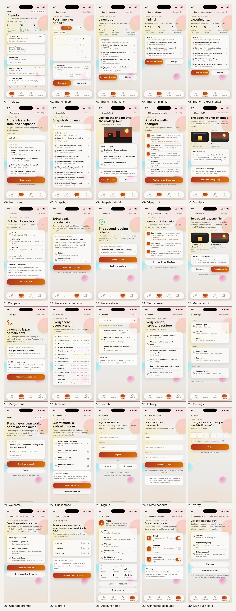
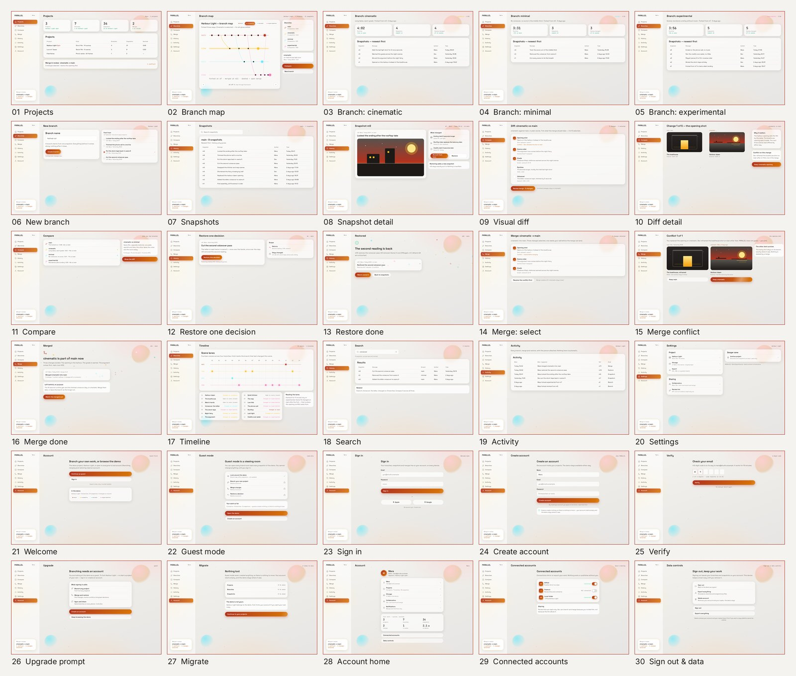

# PARALLEL

**Git for creative work — branches you can live in.**

[Try the live demo](https://mr-vishwet.github.io/parallel/)

*A build specification. The demo project, its people, and its frame art are illustrative.*

## The idea

A film is never one timeline. It is the locked cut, the warmer cut, the quieter cut, the wild cut — and every editor knows what happens when those versions live in filenames: `final-v7-revised`, the good take overwritten, the decision you can never get back. Source control solved this for code decades ago, but it doesn't express creative intent. A diff of a film shouldn't read like a diff of a file.

PARALLEL treats a whole creative project the way code treats a codebase — as something you can branch, compare, and merge — but in the language of the work itself. A branch is a version of the project you can live in: open it, change it, sit with it, and the original is untouched. A diff reads in plain words: *the opening shot changed; the argument now comes before the night ferry; the grade is warmer across the night scenes.* A merge takes only the changes you pick. And when two branches disagree about the same thing, the app never guesses — you pick, and the choice is recorded.

The point isn't version control for its own sake. It's that creative work gets better when trying something costs nothing: fork the cut, go too far, keep the two seconds that worked and leave the rest behind. History only grows, so no decision is ever truly lost.

PARALLEL is local-first: your projects live on your device.

## What it does

### The demo project

The demo opens on **Harbour Light**, a 3:48 short film in 14 scenes, forked four ways:

- **main** — the locked cut, 9 snapshots, 3:48
- **cinematic** — long takes, warm grade, 4 snapshots, 4:02
- **minimal** — no voiceover, no score in the middle third, 3 snapshots, 3:31
- **experimental** — scenes reordered, ending without music, 5 snapshots, 3:56

21 snapshots across the four branches. Two more projects sit alongside it: **Launch Teaser**, a 0:30 brand film with 2 branches and 8 snapshots, and **Field Notes**, a 24-frame photo series with 1 branch and 5 snapshots — 3 projects, 7 branches, 34 snapshots in all. A cinematic → main merge is already in review, with one conflict waiting on the opening shot.

### Branches you can live in

The **branch map** shows the whole project at a glance: four glowing timeline rails, one per branch, with fork points where each branch left the last and a dashed line for the open merge. A snapshot stepper moves through a branch one saved state at a time, so you can step between timelines and feel how the film changes.

Each branch has its own page: runtime against main, snapshot count, how many of the 14 scenes changed, and the snapshot list newest first. Starting a **new branch** means naming it and picking the snapshot to fork from — everything before that snapshot comes along, nothing after it does, and forking never changes main.

### Snapshots

Every saved state is a snapshot with a **message, an author, and a timestamp** — "Held the last light shot for 6 more seconds", Mara, Today 08:20 — so history reads like a diary of decisions, not a pile of files. A snapshot's detail page lists exactly what changed in it: the ending held 6 seconds longer, the rooftop take replacing the balcony take, the credits starting 2 seconds later. Snapshots are never rewritten: restoring or branching always adds a new one, and history only grows.

### Compare, and the visual diff

**Compare** puts any two branches side by side and reads the difference between them in plain words, not between files. The **visual diff** between cinematic and main lists five changes — the opening shot, the scene order, the grade, the runtime, the voiceover — and you tick the ones the merge should take. Each change opens up close: before-and-after frames, what changed, and *why it matters* — the harbour opening sets the film by the water; the boathouse opening sets it inside. The next three scenes read differently either way.

### Merge — only what you pick

**Merge review** shows the changes you selected and refuses to proceed while a conflict is unresolved. A **conflict** screen puts the two versions in front of you — the boathouse, reframed, against the harbour dawn — explains what happens to the losing side (it stays on its branch, exactly where it was; nothing is deleted by a merge), and lets you pick. The **merged** screen then shows what landed and, deliberately, what was left behind on purpose: the changes you didn't pick stay on their branch for the longer cut.

### Restore one decision

Changed your mind about one decision, not the whole branch? **Restore** brings back a single snapshot — the second voiceover pass, say — and shows you the scope first: what returns, and what stays changed. The snapshots after it stay exactly as they are. Restoring creates a new snapshot, so the undo itself is part of history.

### Timeline, search, activity

The **timeline** lists all 14 scenes, one row each, with a mark showing which branch last changed each scene. **Search** looks across branches — search "voiceover" and you get every snapshot that touched it, on every branch, plus the related scenes. The **activity feed** records every branch, merge, and restore with the person attached: Mara merged cinematic into main, Mara restored the second voiceover pass, Dev forked experimental from m7. Nothing here is automatic; everything has a name on it.

**Settings** gathers the project, storage, export, sharing, and archive controls, plus review links for sharing a read-only cut.

### Guest-first

You can browse the whole demo without an account — guest mode is a viewing room: open every branch, read every snapshot, follow every diff. Branching, merging, restoring, and snapshotting need an account, and the app says so at the moment you try, not before. Signing in is email plus a 6-digit code; your account home keeps your projects, collaborators, connected accounts, and data controls (sign out, export everything, delete account) in one place. Guests create nothing, so there is nothing to lose by looking around first.

## The interface

### Mobile — all 30 screens

The full mobile flow: Projects and the branch map, the four branch pages, snapshots, the visual diff, compare, restore, merge and its conflict, the timeline, search, activity, settings — then the guest-first account screens, from Welcome to sign-out.

### Web — all 30 screens

The same thirty screens in the desktop shell: sidebar navigation, the branch map and snapshot tables at full width, the diff and conflict screens with their before-and-after frames side by side.
