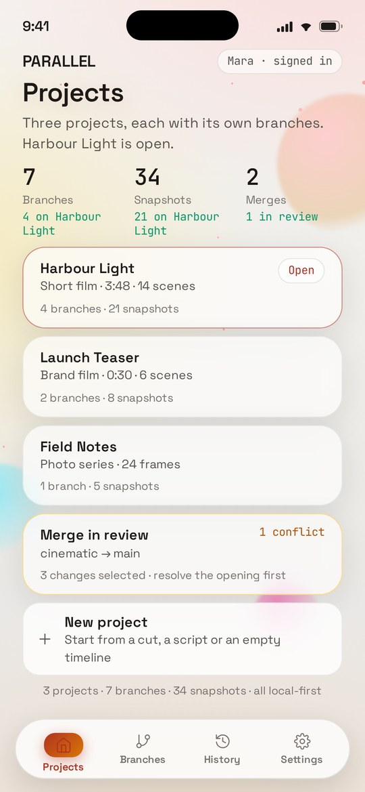
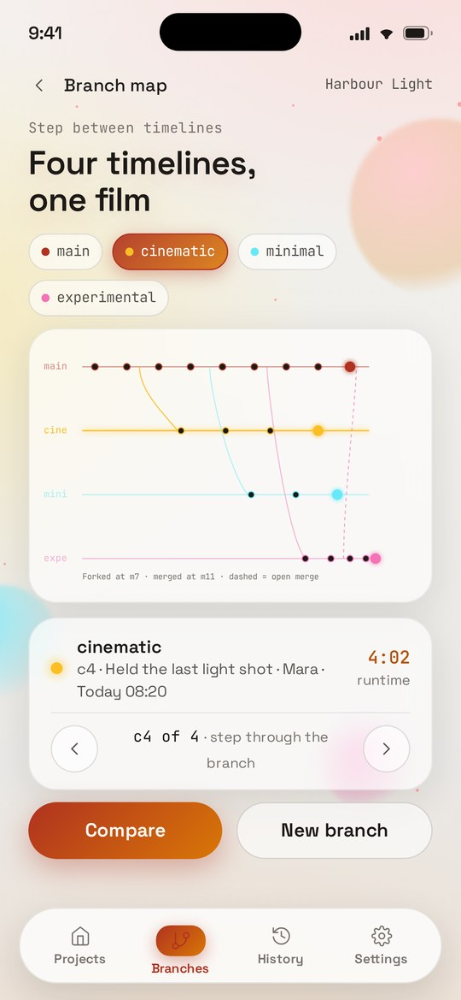
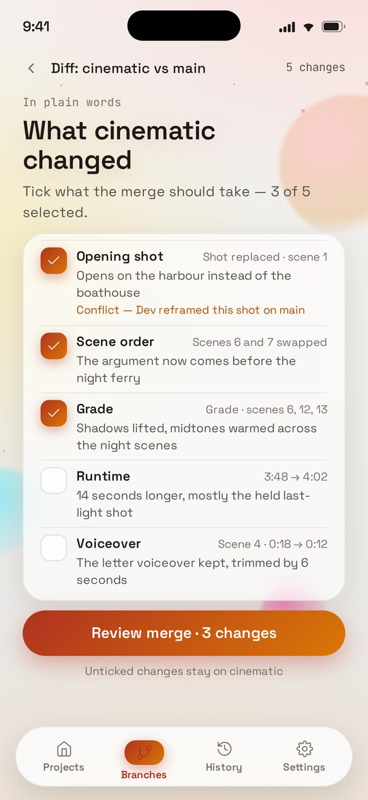
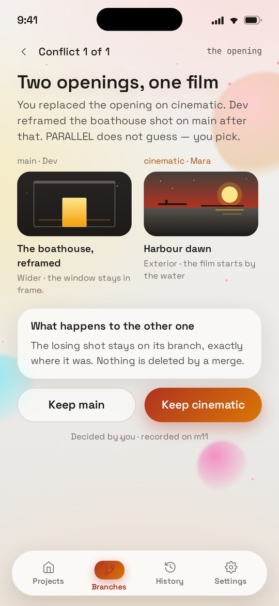
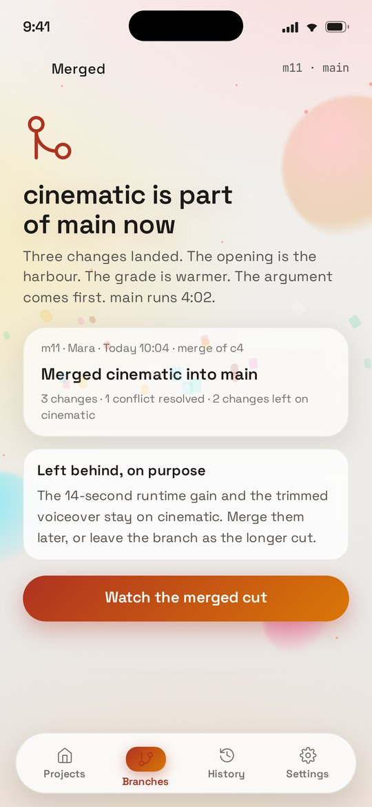

# PARALLEL

**Git for creative work — branch a film, live in each version, merge the best of them.**

*A build specification. The demo project, its people, and its frame art are illustrative.*

A film is never one timeline. It's the locked cut, the warmer cut, the quieter cut, the wild cut — and every editor knows what happens when those versions live in filenames: the good take overwritten, the decision you can never get back. PARALLEL treats a whole creative project the way code treats a codebase — as something you can branch, compare, and merge — but in the language of the work itself. Fork the cut, go too far, keep the two seconds that worked and leave the rest behind. History only grows, so no decision is ever truly lost.

- **Branch map** — four glowing timeline rails, one per branch, with a stepper to move between snapshots and feel how the film changes.
- **Snapshots** — every saved state carries a message, an author, and a timestamp, so history reads like a diary of decisions.
- **Visual diff** — compare any two branches and read the difference in plain words: the opening shot changed, the grade is warmer, the argument now comes first.
- **Merge** — tick only the changes you want; what you don't pick stays on its branch, on purpose.
- **Conflicts** — when two branches disagree about the same thing, PARALLEL never guesses. You pick, and the choice is recorded.
- **Restore** — bring back a single decision without touching the rest; the undo itself becomes part of history.

Browse the whole demo without an account — guest mode is a viewing room. Your projects live on your device.

  
  
  
  
  

[Try the live demo](https://mr-vishwet.github.io/parallel/)
